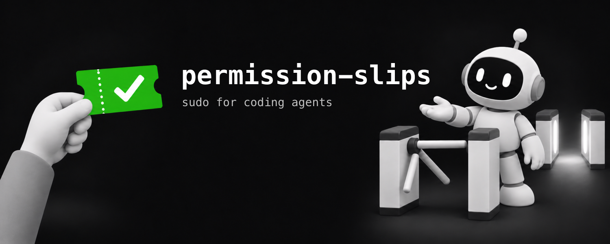
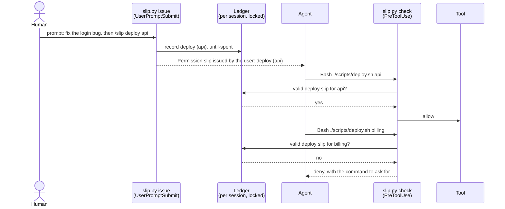

<div align="center">



[](#quickstart)
[](LICENSE)

</div>

> **permission slip** *noun*
> A permission slip grants one risky agent action that only a prompt the human types can issue. It names what the action permits, ends on a defined condition, and a hook outside the model checks it before the tool call runs.
>
> *An agent can't sign its own permission slip.*

The idea comes from sudo, break-glass access and capability tokens. The repo's shape, an essay with working code beside it, comes from 12-Factor Agents by HumanLayer. ([sudo](https://www.sudo.ws/), [12-Factor Agents](https://github.com/humanlayer/12-factor-agents))

## The problem

Coding agents now run deploys, apply database migrations, publish packages, spend money on ad platforms and start many subagents at once. Most of those actions should happen only after you approve them and only for the thing you named.

Writing "never deploy without asking" in the prompt does not enforce the rule. The model treats it as context. A long task, a summarised history or a confident plan can outweigh it, and the agent that broke the rule also decides whether it followed the rule.

Approving every tool call does not enforce the boundary. After the fortieth prompt, you approve without reading, and the call that matters looks like the others.

**How do you give an agent permission for one dangerous thing, for one stretch of work, in a form it cannot forge?**

## How it works

Two hooks share a small ledger. The issue hook reads each prompt you submit and records any slip you typed. The check hook runs before every tool call, matches the call against your rules, and denies a guarded call that holds no valid slip. The model never writes the ledger. It sees only a line saying what was issued or why a call was denied.



## The four rules

The pattern has four rules. Each rule has its own page with the incident behind it and the code that enforces it.

| # | Rule | One line |
|---|------|----------|
| 1 | [Signed by the human](docs/01-signed-by-the-human.md) | Only a prompt you type issues a slip. |
| 2 | [Names the trip](docs/02-names-the-trip.md) | Every slip is scoped to a named target. |
| 3 | [Good for one trip](docs/03-good-for-one-trip.md) | Every slip has a defined end. |
| 4 | [Checked at the door](docs/04-checked-at-the-door.md) | The guard runs outside the model and fails closed. |

## Quickstart

Install the plugin in Claude Code. For Codex, see the Codex setup guide. ([Codex](docs/codex.md), [Claude Code](docs/claude-code.md))

```text
/plugin marketplace add kyisaiah47/permission-slips
/plugin install permission-slips@permission-slips
```

Write a policy. A slip kind says how long a slip lasts. A rule says which tool calls need one. This policy guards a deploy script and takes the target from the command line:

```jsonc
// ~/.config/permission-slips/config.json  (or .permission-slips.json in a project)
{
  "slips": { "deploy": { "lifetime": "until-spent", "needs_target": true, "aliases": ["force-deploy"] } },
  "rules": [
    { "name": "production deploy", "tool": "^(Bash|exec_command)$",
      "pattern": "scripts/deploy\\.sh\\s+(?P<target>[A-Za-z0-9_.-]+)", "slip": "deploy" }
  ]
}
```

Now type the slip anywhere in a prompt:

```text
fix the login bug, then /slip deploy api
```

The issue hook adds one line to the agent's context:

```text
Permission slip issued by the user: deploy (api), good until it is spent.
```

The slip covers `api` and nothing else. If the agent tries another target, the check hook denies the call and tells it what to ask for:

```text
production deploy needs a permission slip. Only the user can issue one, by typing: /slip deploy billing
```

An until-spent slip lasts through failed builds and retries. Your own deploy script ends it once the deploy has been verified live:

```sh
./scripts/deploy.sh "$target"
curl -fsS "https://$target.example.com/health" >/dev/null
python3 ~/.permission-slips/slip.py spend deploy "$target"
```

The fuller example policy is in `slips/config.example.json`.

## How I use them

These are the slips I run every day. Each one exists because something went wrong without it.

| Slip | Lifetime | What it unlocks, and why it exists |
|------|----------|------------------------------------|
| `/force-deploy <repo>...` | until verified live | A slip names the repos to deploy and lasts until the deploy is verified live. Deploys go through one guarded script, and a scheduled nightly deploy is the standing authorization. Between nightlies, the slip names the repos to ship. A failed build, a refused upload or a failed post-deploy check keeps the slip for the retry. Only verified success spends it. |
| `/deploy-all` | until every fix is committed | The deploy command deploys every repo at once. The slip stays valid until every fix I asked for is finished and committed. One deploy then ships every repo, so no half-finished state goes out repo by repo. |
| `/force-ads <platform> <campaign>...` | until armed | A slip arms ad campaigns on one named platform and covers the campaigns named in the prompt. A failed arm keeps the slip, a campaign armed once needs a new slip, and each placement tier on a platform is its own scope. |
| `/allow-multi-agents` | prompt | A slip permits more than one subagent per prompt. One prompt asking for a new page across seven repos started seven agents in parallel. Now the first subagent in a prompt is free and the rest need a slip. |
| `/allow-design-brief` | once | A slip permits one subagent brief that carries design direction and is spent on one call. Colours, palettes and typefaces had gone into briefs without my being consulted, and the work drifted from what I wanted. The slip lets exactly one brief through, then the guard is back. |

The incidents and their details are in How I use them. ([docs/05](docs/05-how-i-use-them.md))

## Slips you could write

The same two hooks cover more than deploys. Each row is a rule plus a slip kind.

| Slip | Guards | Lifetime |
|------|--------|----------|
| `/slip migrate prod` | `prisma migrate deploy --env=prod` and friends | `once` |
| `/slip push main` | `git push` to a protected branch | `once` |
| `/slip publish` | `npm publish`, `twine upload`, `cargo publish` | `once` |
| `/slip infra prod` | `terraform apply`, `kubectl delete` | `once` |
| `/slip spend ads` | a script that raises a budget | `until-spent` |
| `/slip secret STRIPE_KEY` | reading one named secret | `once` |
| `/slip send standup` | sending one message | `once` |
| `/slip egress api.github.com` | `curl`/`wget` to one host | `session` |
| `/slip deps left-pad` | `npm install <pkg>`, `pip install <pkg>` | `prompt` |
| `/slip rm build/` | `rm -rf` on one path | `once` |

Simon Willison's lethal trifecta says an agent with private data, untrusted input and a way to communicate externally can be made to leak. Removing outbound access closes one leg. An egress slip reopens that leg for one named host, for one session, when you decide it is needed. ([the lethal trifecta](https://simonwillison.net/2025/Jun/16/the-lethal-trifecta/))

Config sketches for each row are in Slips you could write. ([docs/06](docs/06-slips-you-could-write.md))

## What it isn't

- **Allowlists and permission modes.** Allowlists and permission modes are standing policy. They say what an agent may always do in a project. A permission slip is a one-time exception to that policy that you issue for a stretch of work and that ends on its own.
- **Bypass mode.** Bypass mode removes every check for the whole session. A slip lifts one check for one named target until a defined end. Everything else stays guarded.
- **Approval prompts the agent triggers.** An approval prompt the agent triggers asks you to judge a call the agent chose to show you, worded the way the agent chose. A slip comes from you first. You type what you want permitted before the agent acts, and the guard holds the agent to it.

<details>
<summary>Using slips with an allowlist</summary>

Slips and allowlists work well together. Keep the allowlist strict, then use slips for the few actions you want gated by intent rather than by command. A slip also leaves a record: the ledger shows what was issued, in which prompt, and whether it was spent.

</details>

## Limits

This is a guard against an agent drifting past your intent, not a sandbox against a hostile one. The full threat model is in its own page. ([threat model](docs/threat-model.md))

- An agent with a shell can try to reach the ledger by indirection, for example by building the path in a variable or writing it from a script. The self-protection check matches path text, so it catches direct writes and not every indirect one.
- For a strong guarantee, keep the ledger where the agent's sandbox cannot write by pointing `PERMISSION_SLIPS_STATE` outside its writable roots.
- The guard only sees tool calls that pass through hooks. A command it allows can start other processes it never sees, and rules match command text, so a guarded action reached by a different command is not caught.

## Also by the author

The same author has other skill repos for Codex and Claude Code:

- [steal](https://github.com/kyisaiah47/steal): Research design precedents and adapt useful mechanisms.
- [brand-pdf](https://github.com/kyisaiah47/brand-pdf): Create documents using a website's real fonts, tokens, and components.
- [mobile-refine](https://github.com/kyisaiah47/mobile-refine): Responsive layout QA beyond overflow checks.
- [session-handoffs](https://github.com/kyisaiah47/session-handoffs): Four fresh-session handoffs between Codex and Claude Code, with portable launchers and duplicate protection.
- [bg-remove](https://github.com/kyisaiah47/bg-remove): Local background removal with clean edge colors.
- [dont-stop-working](https://github.com/kyisaiah47/dont-stop-working): Carry coding-agent tasks through verified completion.

## Prior art and thanks

This repo draws on sudo and its timestamp, break-glass emergency access, capability tokens and object-capability security, the hooks systems in Claude Code and Codex that make an outside guard possible, Simon Willison's writing on the lethal trifecta, and 12-Factor Agents for showing that a set of principles can live in a repo.

## License

Copyright 2026 Isaiah Kim. Released under the skills license in LICENSE: you may install, use and privately adapt it. See LICENSE. Isaiah Kim ([kyisaiah47](https://github.com/kyisaiah47)). [LICENSE](LICENSE) · [PRIVACY.md](PRIVACY.md)
